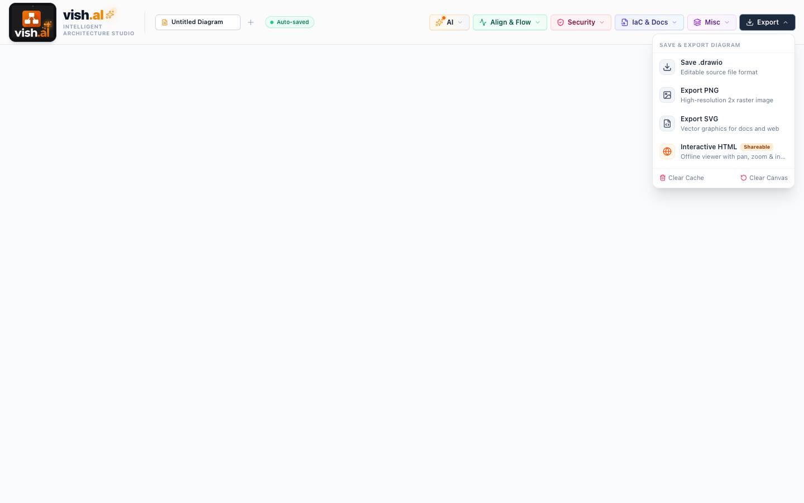

# vish.al Intelligent Architecture Studio

> Cloud-Native Diagramming, AI Synthesis, Zero-Trust Security, FinOps Costing & SLA Reliability Workbench


**`vish.al` Intelligent Architecture Studio** supercharges Draw.io into an enterprise-grade software engineering workbench. Beyond standard diagramming, it incorporates an AI synthesis pipeline, security and SOLID linters, FinOps multi-cloud pricing calculators, SLA/latency critical-path modeling, and zero-dependency standalone HTML exports.

📖 **[Read the Full System Documentation & Visual Guide (docs/SYSTEM_DOCUMENTATION.md)](docs/SYSTEM_DOCUMENTATION.md)**

---

## 🚀 Key Feature Suites & Menu Re-design

| Pastel Menu Group | Color Theme | Included Capabilities |
| :--- | :--- | :--- |
| **`AI`** | Amber / Orange Pastel | **Upload Image / Sketch** (Gemini Vision AI), **Conversational Draw** (Chat Copilot), **Prompt to Architecture** |
| **`Align & Flow`** | Teal / Emerald Pastel | **Auto-Align & Beautify** (Force-directed layout cleaning), **Simulate Traffic Flow** (Animated SVG pulse packets) |
| **`Security`** | Rose / Pink Pastel | **Security & SOLID Audit** (Zero-Trust & SPOF linter with Auto-Fix), **STRIDE Threat Model**, **Chaos Simulator** |
| **`IaC & Docs`** | Indigo / Blue Pastel | **Import Reverse IaC** (Terraform, Compose, K8s), **Export IaC** (HCL, Docker, Mermaid), **Architecture Spec & ADR** |
| **`Misc`** | Purple / Violet Pastel | **Cloud Cost & FinOps** (AWS/GCP/Azure breakdown), **Latency & SLA Calculator**, **SQL / Prisma to ERD**, **Revision History**, **Presentation Mode**, **Command Palette (`⌘K`)** |
| **`Export`** | Slate / Zinc Pastel | **Save .drawio XML**, **Export PNG**, **Export SVG**, **Interactive Standalone HTML** (offline viewer) |

---

## 📸 Visual Snapshots

| Feature | Screenshot |
| :--- | :--- |
| **AI Menu** |  |
| **Latency, SLA & Downtime Calculator** |  |
| **Cloud Cost & FinOps Estimator** |  |
| **STRIDE Threat Modeling** |  |
| **Security & SOLID Audit Drawer** |  |
| **Command Palette (`⌘K`)** |  |
| **Database SQL / Prisma to ERD** |  |
| **Reverse IaC (Terraform / Compose / K8s)** |  |

---

## 🛠️ Quickstart

### 1. Prerequisites
- Node.js 18+
- Modern Web Browser (Chrome, Safari, Edge, Firefox)

### 2. Setup & Installation
```bash
git clone https://github.com/vishalaruru/vdraw.git
cd vdraw
npm install
cp .env.example .env
# Add your Gemini API key to .env:
# VITE_GEMINI_API_KEY=your_gemini_api_key_here
npm run dev
```

The application will run at **`http://localhost:6173`**.

---

## 🧩 Architectural Foundations

- **Host App:** React 19 + TypeScript + Vite + TailwindCSS + Lucide Icons.
- **Canvas Engine:** Embedded Draw.io runtime utilizing asynchronous `postMessage` protocol for XML synchronization, SVG rasterization, and bidirectional command invocation.
- **AI Processing:** Multimodal Google Gemini API with fallback heuristic algorithms for offline or air-gapped usage.
- **Topology Graph Parser:** Custom XML DOM parser extracting node classifications, network boundaries, and edge directions into an adjacency matrix for FinOps and SLA calculations.

---

Distributed under the MIT License. Built with ❤️ for cloud architects and software engineers.
