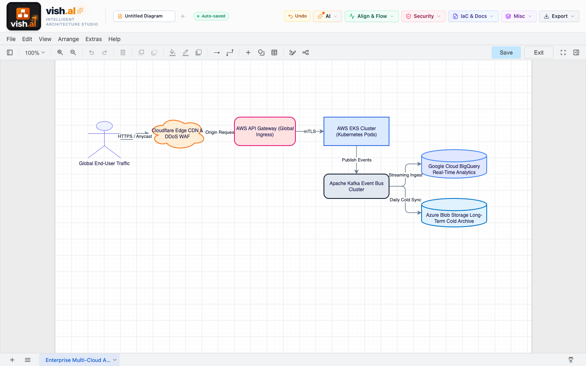
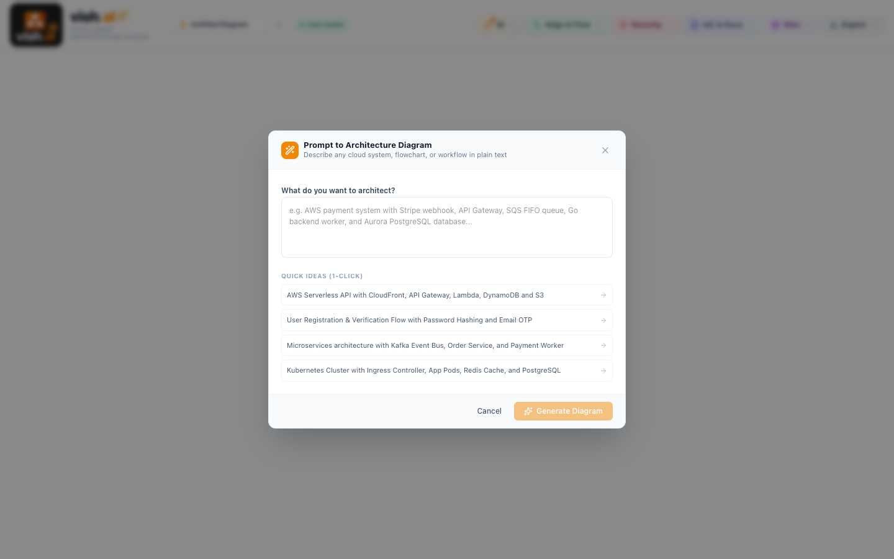
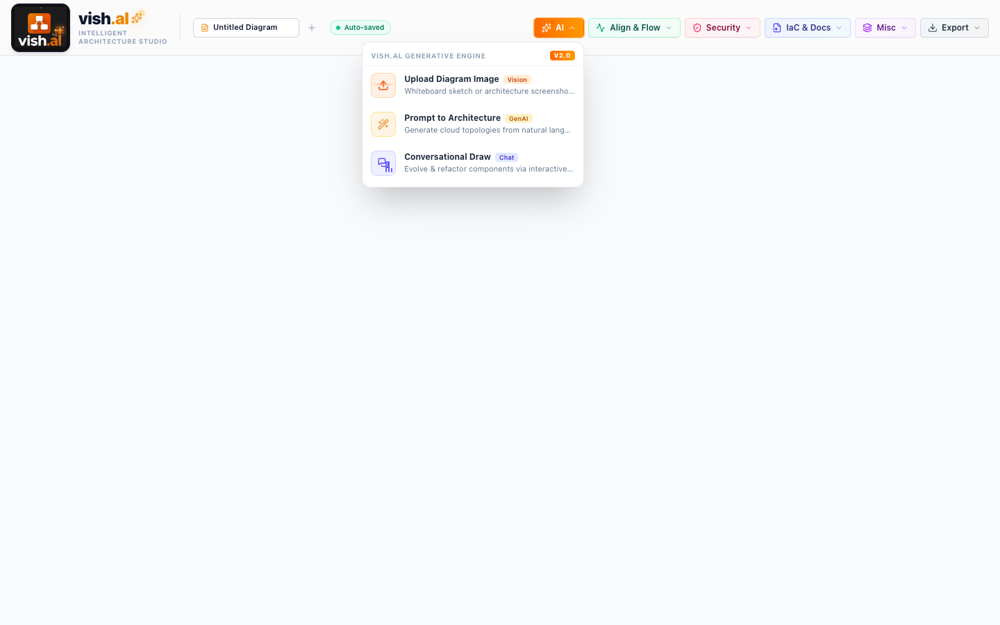
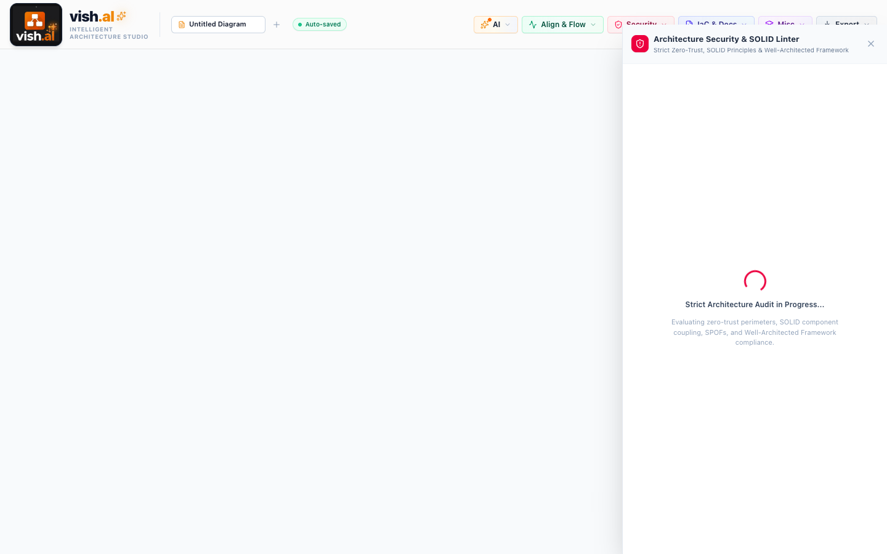
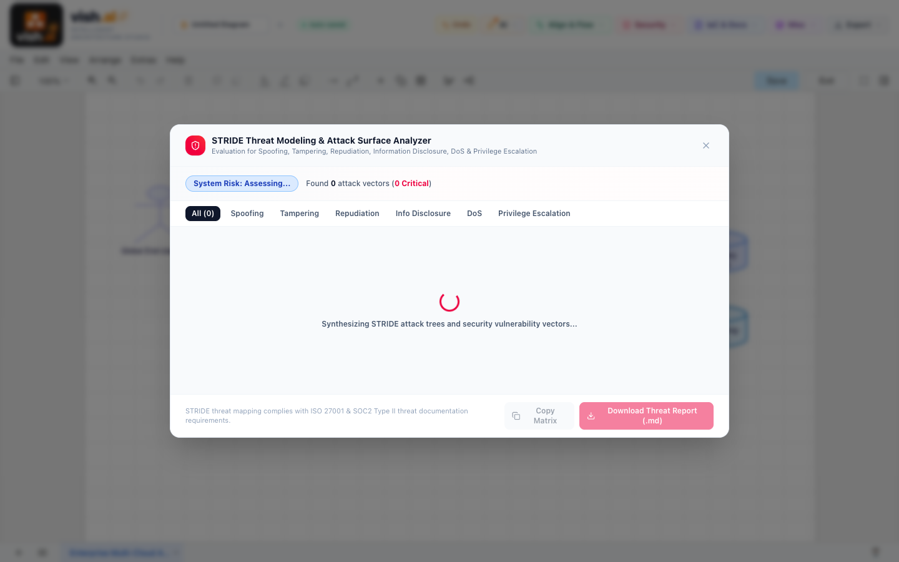
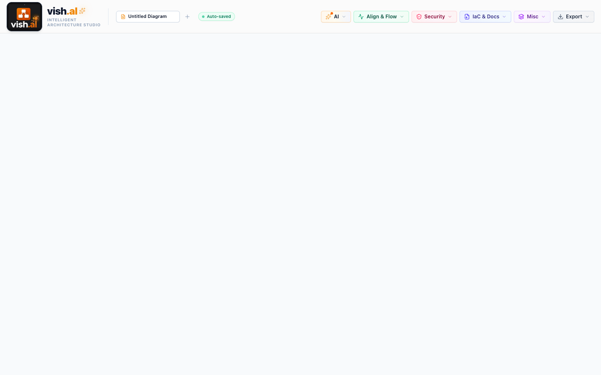
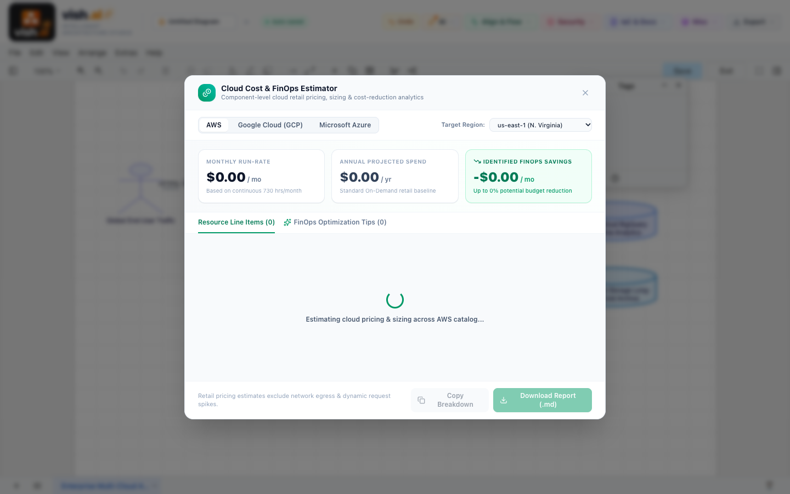
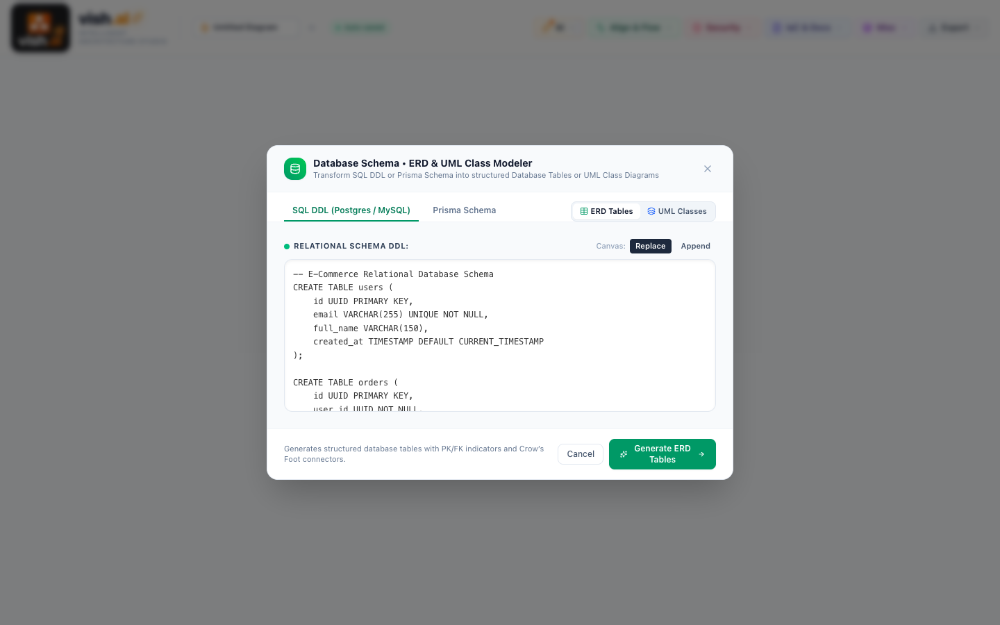
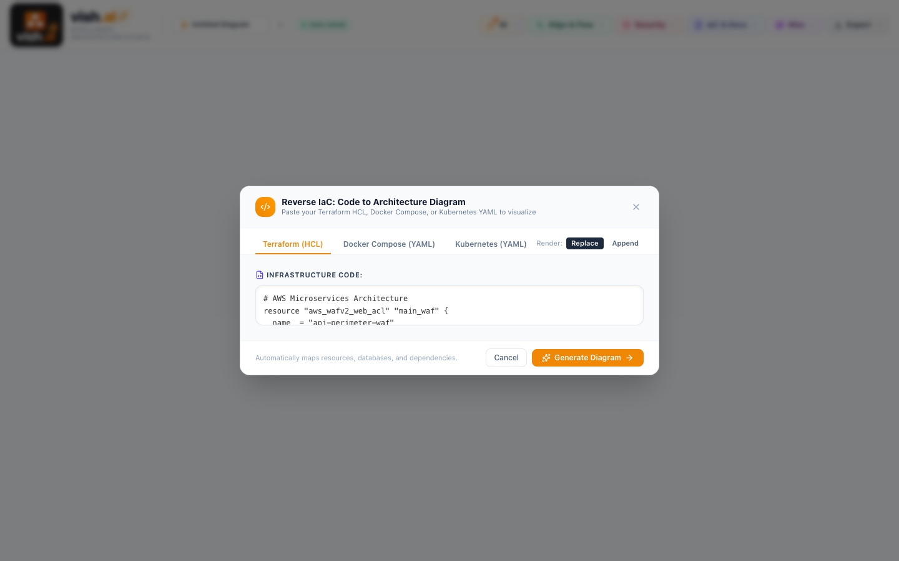

<div align="center">

# 🎨 vish.al Intelligent Architecture Studio

**Turn Draw.io into a cloud-native software engineering workbench.**<br>
*AI synthesis, FinOps cloud costing, Zero-Trust security audits, SLA reliability profiling, and reverse IaC — with zero vendor lock-in.*

[](https://github.com/vishalaruru/vdraw/stargazers)
[](LICENSE)
[](https://www.typescriptlang.org/)
[](https://react.dev/)
[](https://github.com/vishalaruru/vdraw/pulls)

<p align="center">
  <a href="#-quickstart">Quickstart</a> •
  <a href="#-why-vdraw-comparison">Why vdraw?</a> •
  <a href="#-features-suite">Features Suite</a> •
  <a href="docs/EXECUTIVE_SUMMARY.html">Executive Summary (HTML)</a> •
  <a href="docs/SYSTEM_DOCUMENTATION.md">Full Technical Guide</a>
</p>

---

⭐ **If you find this project exciting or useful, please give it a star on GitHub! It helps the project grow and reach more architects.**

---



</div>

---

## ⚡ The Elevator Pitch

Traditional diagramming tools like standard Draw.io, Visio, or Lucidchart treat architecture diagrams as **passive drawings** — static boxes and lines with zero semantic awareness.

**`vish.al Intelligent Architecture Studio`** reimagines the canvas as an **active engineering environment**:
1. 📸 **Turns whiteboard photos and napkin sketches into editable diagrams** in seconds using Multimodal Gemini Vision.
2. 🛡️ **Lints your architecture for Zero-Trust security vulnerabilities, SPOFs, and STRIDE attack vectors** with 1-click Auto-Fix.
3. 💰 **Calculates monthly cloud bills across AWS, GCP, and Azure** right on the canvas with FinOps optimization tips.
4. ⏱️ **Computes composite SLAs ($A = \prod A_i$), allowed downtime budgets, and P95 latency bottlenecks**.
5. 🔄 **Reverses Terraform HCL, Docker Compose, and Kubernetes YAML into visual diagrams** (and exports diagrams back to IaC).
6. 🌐 **Exports standalone zero-dependency interactive HTML viewers** with pan, zoom, search, and node inspection.

---

## 📊 Why vdraw? (Comparison)

| Capability | Vanilla Draw.io | Lucidchart / Visio | IcePanel / Cloudcraft | 🎨 vdraw Studio |
| :--- | :---: | :---: | :---: | :---: |
| **Open-Source & 100% Free** | ✅ | ❌ (Expensive) | ❌ (Subscription) | **✅ MIT Licensed** |
| **Whiteboard Photo to Editable Shapes** | ❌ | ❌ | ❌ | **✅ Multimodal AI** |
| **Conversational Chat Copilot** | ❌ | ❌ | ❌ | **✅ Built-in** |
| **Prompt to Multi-Tier Architecture** | ❌ | ❌ | ❌ | **✅ Built-in** |
| **Multi-Cloud FinOps Costing (AWS/GCP/Azure)** | ❌ | ❌ | ⚠️ (AWS only) | **✅ Multi-Cloud** |
| **Zero-Trust & SOLID Architecture Linter** | ❌ | ❌ | ❌ | **✅ With 1-Click Auto-Fix** |
| **STRIDE Threat Modeling Engine** | ❌ | ❌ | ❌ | **✅ Automated** |
| **Composite SLA & P95 Bottleneck Calculator** | ❌ | ❌ | ❌ | **✅ Built-in** |
| **Chaos Monkey / Blast Radius Simulation** | ❌ | ❌ | ❌ | **✅ Visual Red Outages** |
| **Live Request Traffic Flow Simulation** | ❌ | ❌ | ❌ | **✅ Animated SVG Pulses** |
| **Code to Diagram (Reverse Terraform / K8s)** | ❌ | ❌ | ❌ | **✅ Native Parser** |
| **Database SQL / Prisma to ERD** | ❌ | ⚠️ (Manual import) | ❌ | **✅ Instant DDL/Prisma** |
| **Zero-Dependency Standalone HTML Export** | ❌ | ❌ | ❌ | **✅ Offline Single-File** |
| **Draw.io Native Menus & File Format** | ✅ | ❌ | ❌ | **✅ 100% Preserved** |

---

## 🚀 Feature Suites

### 1. 🤖 AI Architecture Suite
Turn unstructured inputs into enterprise diagrams without manual dragging.
- **Vision AI Upload:** Drop whiteboard photos or architecture screenshots to extract shapes, labels, and orthogonal arrows.
- **Conversational Draw (Copilot):** Natural language chat bar to insert nodes, add caches, or re-route network topologies.
- **Prompt to Architecture:** Functional prompt synthesis for microservices, video streaming, ride-sharing, and FinTech pipelines.

<p align="center">
  
  
</p>

---

### 2. 🛡️ Security, Zero-Trust & Resilience
Catch architectural security bugs months before code hits production.
- **Security & SOLID Linter:** Scans for unencrypted database egress, missing WAFs, and single points of failure. Includes 1-click **Auto-Fix** to inject security perimeters.
- **STRIDE Threat Modeler:** Automatic classification across Spoofing, Tampering, Repudiation, Info Disclosure, DoS, and Elevation of Privilege.
- **Chaos Simulator (Blast Radius):** Injects node outages (e.g. Primary DB down) to highlight cascading impact paths in red.

<p align="center">
  
  
</p>

---

### 3. ⏱️ Latency, SLA & Availability Calculator
Mathematical reliability modeling for distributed systems.
- **Composite Availability ($A = \prod A_i$):** Calculate series uptime across all connected cloud services.
- **Downtime Budgets:** Exact maximum downtime per year, month, and day for 99.9%, 99.99%, and 99.999% targets.
- **Critical Path Latency (P50/P95/P99):** Aggregates end-to-end request hop latencies and flags the primary bottleneck.

<p align="center">
  
</p>

---

### 4. 💰 Cloud Cost & FinOps Estimator
Know your cloud bill before provisioning a single server.
- **Multi-Cloud Pricing:** Sizing breakdown across AWS, GCP, and Azure.
- **FinOps Optimization:** Highlights underutilized provisioned resources and recommends reserved instances and caching.

<p align="center">
  
</p>

---

### 5. 🛠️ Code, IaC & Database Interoperability
- **Import Reverse IaC:** Ingests Terraform `.tf`, `docker-compose.yml`, and Kubernetes YAML into visual diagrams.
- **Export IaC & Code:** Compiles diagrams into Terraform HCL, Docker Compose, and Mermaid.js.
- **SQL / Prisma to ERD:** Converts database DDL and Prisma models into Entity Relationship Diagrams with foreign keys.
- **Interactive Standalone HTML Export:** Exports diagrams as zero-dependency `.html` files with pan, zoom, search, and a node inspector drawer.

<p align="center">
  
  
</p>

---

## 🛠️ Quickstart

### 1. Prerequisites
- [Node.js](https://nodejs.org/) v18 or higher
- npm or yarn or pnpm

### 2. Run Locally
```bash
# 1. Clone the repository
git clone https://github.com/vishalaruru/vdraw.git
cd vdraw

# 2. Install dependencies
npm install

# 3. Configure your environment
cp .env.example .env
# Optional: Add your Gemini API key for AI generation (heuristic fallback works offline!)
# VITE_GEMINI_API_KEY=your_key_here

# 4. Start the studio
npm run dev
```

Open **`http://localhost:6173`** in your browser.

---

## ⌨️ Shortcuts & Productivity

| Shortcut | Action |
| :--- | :--- |
| **`⌘K` / `Ctrl+K`** | Open Command Palette (fuzzy-search every tool and modal) |
| **`⌘S` / `Ctrl+S`** | Quick Save `.drawio` XML |
| **`⌘Z`** | Undo canvas edit |
| **`⌘⇧Z` / `⌘Y`** | Redo canvas edit |
| **Double-Click Tab** | Rename diagram tab inline |

---

## 📚 Detailed Documentation

- 📑 **[Executive Summary Dashboard (HTML)](docs/EXECUTIVE_SUMMARY.html)**: 6-pillar analysis for each module (What is it, How to use, Why, Motive, How it helps, Why use this).
- 📖 **[System Documentation & Architecture Guide (Markdown)](docs/SYSTEM_DOCUMENTATION.md)**: Deep technical breakdown, Mermaid sequence diagrams, and mathematical formulas.

---

## 🤝 Contributing

Contributions, bug reports, and feature requests are very welcome!
1. Fork the Project
2. Create your Feature Branch (`git checkout -b feature/AmazingFeature`)
3. Commit your Changes (`git commit -m 'Add some AmazingFeature'`)
4. Push to the Branch (`git push origin feature/AmazingFeature`)
5. Open a Pull Request

---

## 📜 License

Distributed under the **MIT License**. See `LICENSE` for details.

---

<div align="center">
  <strong>⭐ Found this helpful? Star the repository to show your support! ⭐</strong><br>
  Built with ❤️ for architects, SREs, and software engineers worldwide.
</div>
