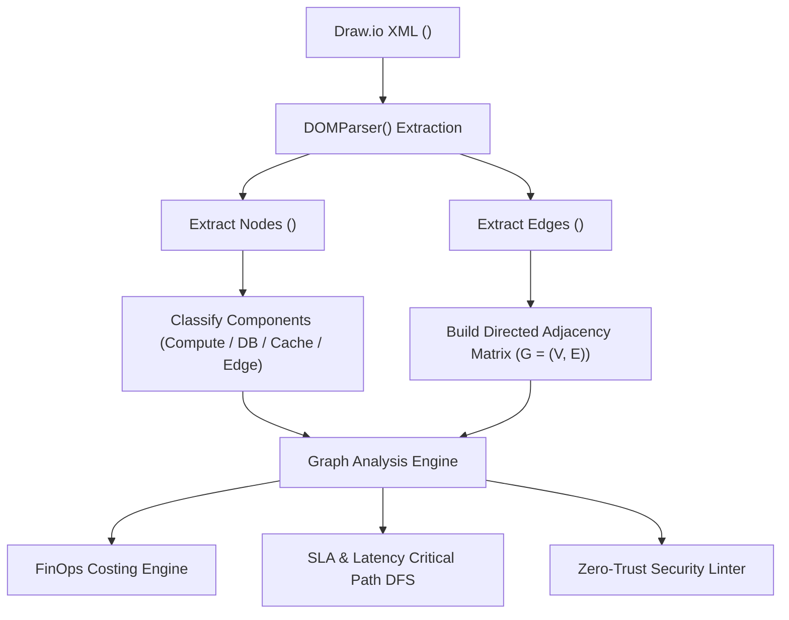

# 🧠 Architecture Internals & Engineering Specification

This document details the internal design, communication protocols, graph algorithms, and architectural models powering **vish.al Intelligent Architecture Studio**.

---

## 1. Bidirectional Iframe Bridge (`DrawioEditor.tsx`)

The studio hosts the core Draw.io vector engine inside an isolated `<iframe>` pointing to `https://embed.diagrams.net/?embed=1&proto=json`. Communication between the React host application and Draw.io occurs through a strict `window.postMessage` asynchronous protocol.

```
+-------------------------------------------------------------+
|                 vish.al React Host Studio                   |
|                                                             |
|  [Tabs] [Pastel Menus] [Copilot Bar] [SLA & FinOps Modals]  |
+------------------------------+------------------------------+
                               |
                   postMessage | (JSON protocol)
                               v
+-------------------------------------------------------------+
|               Embedded Draw.io Engine (Iframe)              |
|                                                             |
|      [Canvas Grid]  [Shapes Palette]  [Format Inspector]     |
+-------------------------------------------------------------+
```

### Protocol Lifecycle Events

| Event | Initiator | Payload / Action | Purpose |
| :--- | :--- | :--- | :--- |
| `configure` | Draw.io &rarr; Host | `{ event: 'configure' }` | Iframe requests studio configuration. |
| `configure (ack)` | Host &rarr; Draw.io | `{ action: 'configure', config: { defaultLibraries, pageVisible: 0 } }` | Host enables enterprise libraries (AWS4, GCP, Azure, K8s, UML, ERD). |
| `init` | Draw.io &rarr; Host | `{ event: 'init' }` | Canvas engine is initialized and ready for document injection. |
| `load` | Host &rarr; Draw.io | `{ action: 'load', xml: currentXml, autosave: 1 }` | Injects diagram XML into canvas without full iframe reload. |
| `autosave` | Draw.io &rarr; Host | `{ event: 'autosave', xml: updatedXml }` | Fired on every user stroke or shape drag. Host debounces and updates `localStorage`. |
| `export` | Host &rarr; Draw.io | `{ action: 'export', format: 'xml' | 'svg' }` | Host requests instantaneous pure SVG vector or XML snapshot. |

---

## 2. Topology Graph Extraction Algorithm (`architectureAuditor.ts`)

To calculate FinOps costs, SLAs, threat models, and security audits, the studio translates raw Draw.io XML into a directed adjacency graph:



### Parsing Pipeline:
1. **Node Extraction:** Iterates `<mxCell vertex="1">`, reading shape attributes, dimensions (`width`, `height`), position (`x`, `y`), and raw label HTML.
2. **Component Classification:** Matches labels and shape styles against regular expression signatures:
   - *Database:* `postgres`, `mysql`, `rds`, `dynamo`, `mongodb`, `cylinder` shape.
   - *Cache:* `redis`, `memcached`, `elasticache`.
   - *Queue/Stream:* `kafka`, `sqs`, `eventbridge`, `pubsub`, `rabbitmq`.
   - *Compute:* `eks`, `k8s`, `ecs`, `lambda`, `service`, `api`.
   - *Ingress/Edge:* `waf`, `cloudfront`, `cloudflare`, `alb`, `gateway`.
3. **Edge Construction:** Maps source node IDs (`source="cellId"`) to target node IDs (`target="cellId"`), determining dependency directions.

---

## 3. SLA & Tail-Latency Calculation Model (`slaLatencyCalculator.ts`)

### Mathematical Foundation:
1. **Composite Availability Calculation:**
   $$A_{\text{composite}} = \prod_{i=1}^{n} \frac{\text{availabilityPct}_i}{100} \times 100$$
2. **Allowed Downtime Durations:**
   - $\text{Yearly Downtime} = (1 - \frac{A_{\text{composite}}}{100}) \times 365.25 \times 86400 \text{ seconds}$
   - $\text{Monthly Downtime} = \frac{\text{Yearly Downtime}}{12}$
   - $\text{Daily Downtime} = \frac{\text{Yearly Downtime}}{365.25}$
3. **Critical Request Path DFS:**
   Finds the longest latency path from root ingress nodes to terminal storage sinks using Depth-First Search (DFS):
   $$\text{Path Latency (P95)} = \sum_{h \in \text{Path}} \text{latencyP95}_h$$
4. **Bottleneck Flagging:**
   The hop consuming the largest percentage of total request path duration is designated as the primary bottleneck:
   $$\text{Bottleneck Ratio} = \frac{\max(\text{latencyP95}_h)}{\text{Path Latency (P95)}} \times 100\%$$

---

## 4. Standalone Interactive HTML Generation (`standaloneHtmlGenerator.ts`)

The HTML export generates a **zero-dependency, single-file distribution**:
- Pure SVG is extracted from the Draw.io engine using an asynchronous export handshake.
- A vanilla CSS/JS viewer bundle is interpolated around the SVG.
- Contains a 60fps hardware-accelerated pan-and-zoom transformation matrix:
  $$\text{transform} = \text{translate}(T_x, T_y) \times \text{scale}(S)$$
- Real-time search traverses SVG text nodes, dimming non-matching elements with `opacity: 0.15` and applying a pulse spotlight to matched components.
