# vish.al Intelligent Architecture Studio — Complete System Documentation & Visual Guide

Welcome to the comprehensive technical documentation for **`vish.al` Intelligent Architecture Studio**. This document provides an elaborated breakdown of the architectural redesign of Draw.io, its pastel navigation hierarchy, AI toolchain, security and resilience linters, FinOps cost modeling, SLA and latency calculators, and standalone interactive exports.

---

## Table of Contents
1. [Executive Overview & Vision](#1-executive-overview--vision)
2. [Redesign & Studio UI Architecture](#2-redesign--studio-ui-architecture)
   - [2.1 Brand Identity & Twinkling AI Logo](#21-brand-identity--twinkling-ai-logo)
   - [2.2 Workspace Tabs, Renaming & Auto-Save](#22-workspace-tabs-renaming--auto-save)
   - [2.3 Pastel-Themed Navigation System](#23-pastel-themed-navigation-system)
   - [2.4 Draw.io Native Menu & Toolbar Preservation](#24-drawio-native-menu--toolbar-preservation)
3. [Elaborated Menu Suite & Snapshots](#3-elaborated-menu-suite--snapshots)
   - [3.1 Group 1: AI Architecture Suite](#31-group-1-ai-architecture-suite)
   - [3.2 Group 2: Align & Flow (Canvas Layout & Motion)](#32-group-2-align--flow-canvas-layout--motion)
   - [3.3 Group 3: Icon Beautify (Cloud Stencils & Web Brand Logos)](#33-group-3-icon-beautify-cloud-stencils--web-brand-logos)
   - [3.4 Group 4: Security & Resilience (Zero-Trust & Chaos)](#34-group-4-security--resilience-zero-trust--chaos)
   - [3.5 Group 5: IaC & Technical Documentation](#35-group-5-iac--technical-documentation)
   - [3.6 Group 6: Miscellaneous (FinOps, Latency/SLA, ERD, Presentation)](#36-group-6-miscellaneous-finops-latencysla-erd-presentation)
   - [3.7 Group 7: Save & Export (Drawio, PNG, SVG, Interactive HTML)](#37-group-7-save--export-drawio-png-svg-interactive-html)
4. [Deep-Dive Feature Modals & Engines](#4-deep-dive-feature-modals--engines)
   - [4.1 Latency, SLA & Availability Calculator](#41-latency-sla--availability-calculator)
   - [4.2 Cloud Cost & FinOps Estimator](#42-cloud-cost--finops-estimator)
   - [4.3 STRIDE Threat Modeling](#43-stride-threat-modeling)
   - [4.4 Security & SOLID Architecture Auditor](#44-security--solid-architecture-auditor)
   - [4.5 Command Palette (⌘K)](#45-command-palette-k)
   - [4.6 Database SQL / Prisma to ERD](#46-database-sql--prisma-to-erd)
   - [4.7 Reverse IaC Engine](#47-reverse-iac-engine)
   - [4.8 Architecture to AI Prompt Engine (Reverse Engineering)](#48-architecture-to-ai-prompt-engine-reverse-engineering)
   - [4.9 Icon Beautifier & Web-Augmented Brand Logo Engine](#49-icon-beautifier--web-augmented-brand-logo-engine)
   - [4.10 Deterministic Layout Beautifier & Obstacle Avoidance Routing](#410-deterministic-layout-beautifier--obstacle-avoidance-routing)
   - [4.11 Conversational Diagram Copilot & Directional Grammar](#411-conversational-diagram-copilot--directional-grammar)
   - [4.12 UI & UX Ergonomics (Pinned Drawer Tabs & Responsive Chaos Controls)](#412-ui--ux-ergonomics-pinned-drawer-tabs--responsive-chaos-controls)
5. [Architecture & Communication Flow](#5-architecture--communication-flow)

---

## 1. Executive Overview & Vision

**`vish.al` Intelligent Architecture Studio** transforms traditional, passive diagramming into an active, intelligent software engineering workbench. Beyond standard vector drawing, the studio continuously analyzes diagrams to deliver:
- **Instant AI Synthesis:** Sketch-to-diagram, natural language prompts, and conversational diagram iteration.
- **Reliability Engineering:** Serial composite availability ($A = \prod A_i$), tail-latency profiling (P50/P95/P99), and critical bottleneck detection.
- **Architectural Linting:** Automated checks for Zero-Trust boundaries, single points of failure (SPOF), and SOLID principles.
- **FinOps Intelligence:** Multi-cloud cost breakdown (AWS, GCP, Azure) and budget optimization recommendations.
- **Code & IaC Interoperability:** Bi-directional import and export between visual diagrams and Terraform, Docker Compose, Kubernetes, and SQL/Prisma schemas.

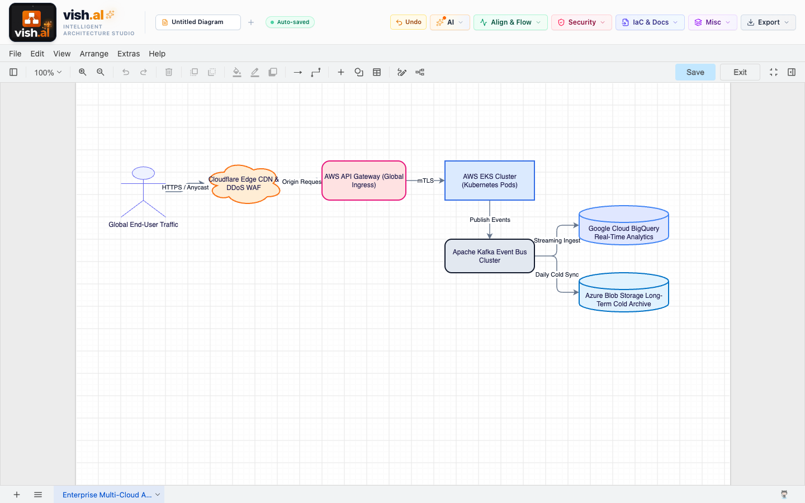

---

## 2. Redesign & Studio UI Architecture

### 2.1 Brand Identity & Twinkling AI Logo
The header was elevated with a prominent branding layer:
- **Brand Emblem:** The `vish.al` badge features a high-contrast cloud architecture symbol with embedded AI sparkle motifs.
- **Brand Typography:** Bold `vish.al` headline with a gold-sparkle twinkling indicator (`AI`) and the subtitle:
  `Intelligent Architecture Studio`
- **Proportional Scaling:** Double-sized brand container seamlessly integrated without overlapping canvas tools.

### 2.2 Workspace Tabs, Renaming & Auto-Save
- **Editable Diagram Titles:** Click directly on the title tab (e.g. `Untitled Diagram`) to rename it with immediate persistence.
- **Multi-Tab Architecture:** Support for multiple diagrams within a single session via the `+` button.
- **Persistent LocalStorage Auto-Save:** Canvas state is automatically serialized and saved with debouncing.
- **Reload Protection:** Prevents accidental data loss by hooking `beforeunload` to warn the user if unsaved changes exist.

### 2.3 Pastel-Themed Navigation System
To replace cluttered toolbars with a clean design, tools are categorized into 6 pastel-themed dropdown menus:
1. **AI (Amber/Orange Pastel):** AI generation, sketch upload, and conversational copilot.
2. **Align & Flow (Teal/Emerald Pastel):** Layout beautifier and animated request packet simulation.
3. **Security (Rose/Pink Pastel):** Security & SOLID auditor, STRIDE threat modeler, and Chaos Monkey.
4. **IaC & Docs (Indigo/Blue Pastel):** Reverse IaC parser, Terraform/Mermaid exporter, and ADR technical specs.
5. **Misc (Purple/Fuchsia Pastel):** FinOps cost breakdown, Latency/SLA calculator, SQL/Prisma ERD, Revision history, Presentation mode, and `⌘K` palette.
6. **Export (Slate/Zinc Pastel):** Native Draw.io XML, PNG, SVG, and Standalone Interactive HTML.

### 2.4 Draw.io Native Menu & Toolbar Preservation
The original Draw.io menus (`File`, `Edit`, `View`, `Arrange`, `Extras`, `Help`) and toolbar controls (zoom, undo, redo, format panels) are preserved below the studio bar.

---

## 3. Elaborated Menu Suite & Snapshots

### 3.1 Group 1: AI Architecture Suite
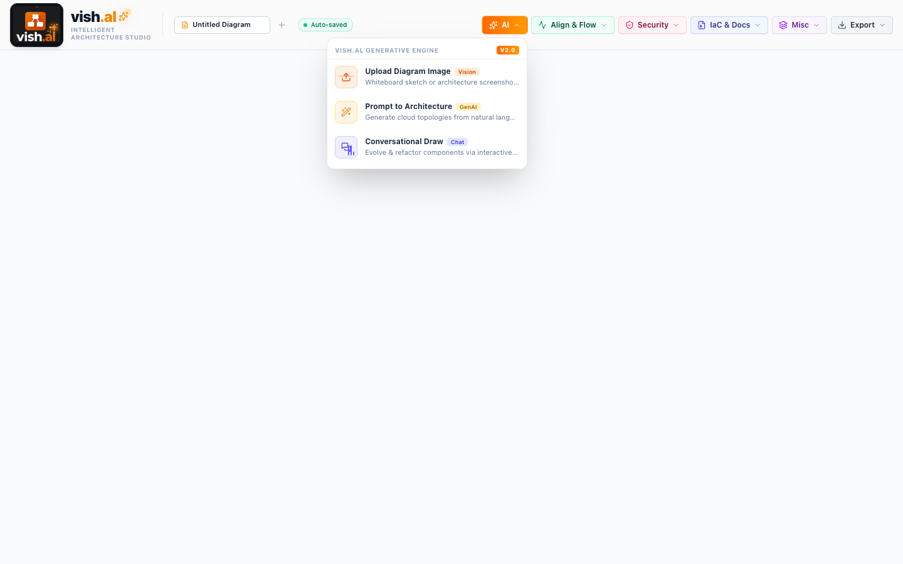

- **Upload Architecture Image / Sketch:** Employs multimodal Gemini Vision to convert whiteboard sketches, architectural screenshots, or hand-drawn notes into editable Draw.io XML shapes.
- **Conversational Draw (Copilot):** Natural language chat bar allowing users to request modifications (e.g. *"Add a Redis cache before Postgres"* or *"Wrap payment services in a private subnet"*).
- **Prompt to Architecture:** Generates complete architectures from simple natural language briefs with automatic tiering, cloud icons, and connections.
- **Architecture → AI Prompt (Reverse Prompt):** Reverse-engineers any diagram on canvas into an unambiguous, highly-structured natural language prompt, RFC engineering specification, and Mermaid graph that can be fed into any AI model to reproduce the exact same architecture flow.

---

### 3.2 Group 2: Align & Flow (Canvas Layout & Motion)
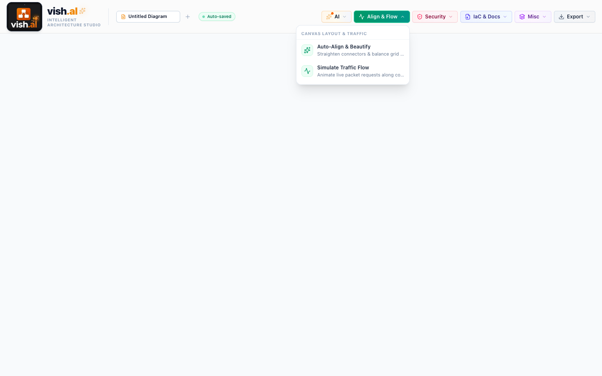

- **Auto-Align & Beautify:** Algorithmically adjusts node spacing, aligns peer services along horizontal/vertical grids, and removes overlapping connector paths with obstacle avoidance routing.
- **Simulate Traffic Flow:** Injects animated SVG pulse strokes along connector paths to visualize live simulated HTTP/gRPC request flows across the system.

---

### 3.3 Group 3: Icon Beautify (Cloud Stencils & Web Brand Logos)

- **✨ Instant Auto-Beautify:** 1-click batch upgrade replacing generic rectangle and cylinder shapes with official AWS, GCP, Azure, Kubernetes, and database stencil icons while preserving 100% of arrows and coordinates.
- **🔍 Preview & Select Icons Modal:** Interactive dialog showing detected components, categorized by provider with live logo preview thumbnails, select/deselect toggles, and search filters.
- **🌐 AI Web Brand Search:** Grounded search leveraging Gemini and Google High-Res Favicon CDN to recognize proprietary SaaS, streaming services (Conviva, Bitmovin, Axinom, DAZN), and third-party developer platforms.

---

### 3.4 Group 4: Security & Resilience (Zero-Trust & Chaos)
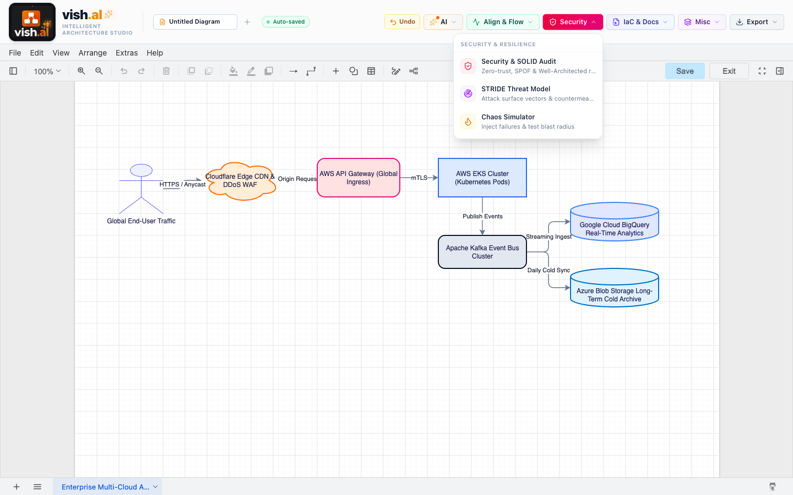

- **Security & SOLID Audit:** Scans diagram nodes and edges against Zero-Trust network rules, unencrypted database boundaries, and single points of failure (SPOF) with pinned filter tabs.
- **STRIDE Threat Model:** Analyzes components against Spoofing, Tampering, Repudiation, Information Disclosure, Denial of Service, and Elevation of Privilege.
- **Chaos Simulator (Blast Radius):** Simulates component outages (e.g., database failure) and highlights cascading impact paths across the diagram with a floating, draggable control bar.

---

### 3.5 Group 5: IaC & Technical Documentation
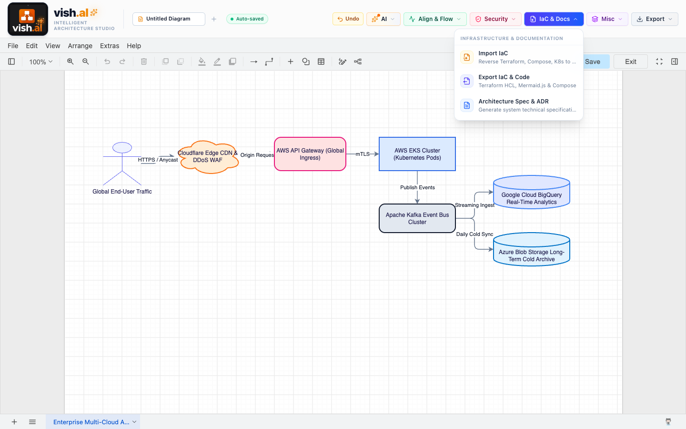

- **Import IaC:** Reverses Terraform HCL, Docker Compose YAML, and Kubernetes manifests into visual cloud topology diagrams.
- **Export IaC & Code:** Compiles the visual diagram into production-ready Terraform definitions, Docker Compose files, and Mermaid.js diagrams.
- **Architecture Spec & ADR:** Generates markdown architectural specifications and Architecture Decision Records (ADR).

---

### 3.6 Group 6: Miscellaneous (FinOps, Latency/SLA, ERD, Presentation)
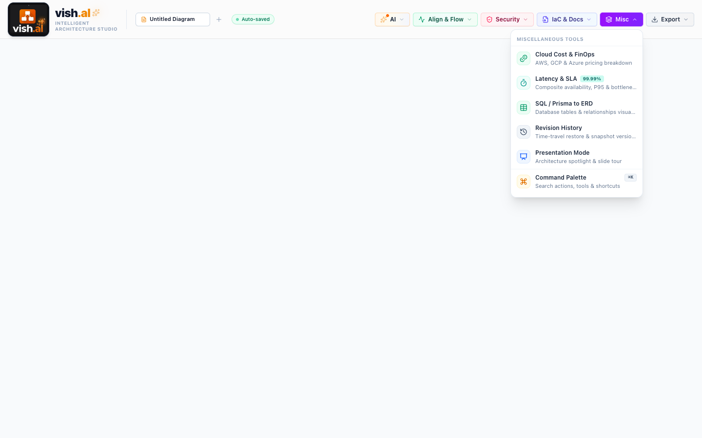

- **Cloud Cost & FinOps:** Analyzes components to calculate estimated monthly run rates across AWS, GCP, and Azure with FinOps savings opportunities.
- **Latency & SLA:** Calculates end-to-end composite availability, allowed downtime budgets, P95 critical request paths, and bottleneck hops.
- **SQL / Prisma to ERD:** Generates interactive Entity Relationship Diagrams directly from SQL DDL statements or Prisma schema definitions.
- **Revision History:** Time-travel version control with one-click snapshot rollback and version diffs.
- **Presentation Mode:** Turns diagrams into interactive architectural slide decks with spotlight navigation.
- **Command Palette (`⌘K`):** Global quick-action search modal for navigating studio tools and commands.

---

### 3.7 Group 7: Save & Export (Drawio, PNG, SVG, Interactive HTML)
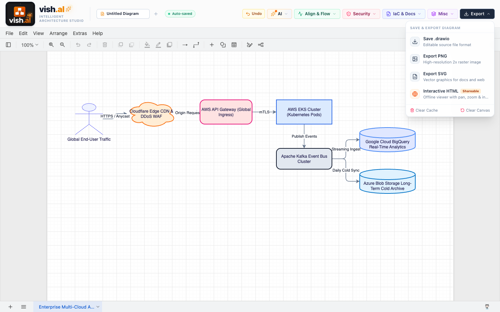

- **Save Diagram (.drawio):** Native XML format compatible with any Draw.io instance.
- **Export PNG & SVG:** High-resolution raster and scalable vector graphics.
- **Export Standalone Interactive HTML:** Bundles the diagram into a zero-dependency, self-contained offline viewer with interactive pan/zoom, search filters, and a node inspector drawer.

---

## 4. Deep-Dive Feature Modals & Engines

### 4.1 Latency, SLA & Availability Calculator
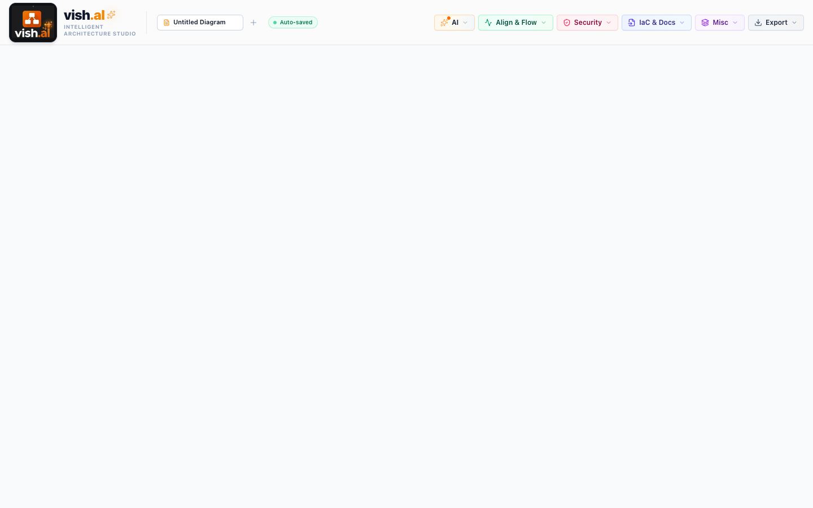

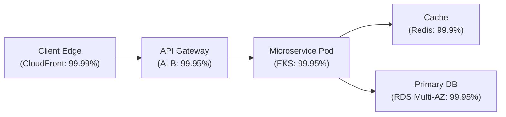

#### Reliability Metrics Calculated:
1. **Composite Availability ($A$):**
   $$A_{\text{composite}} = \prod_{i=1}^{n} A_i$$
2. **Downtime Budgets:**
   - **Yearly Downtime:** $(1 - A_{\text{composite}}) \times 365.25 \times 24 \times 3600 \text{ seconds}$
   - **Monthly Downtime:** Yearly Downtime $\div 12$
   - **Daily Downtime:** Yearly Downtime $\div 365.25$
3. **Tail Latency Profiling:** Critical path DFS computes additive network and compute latency for P50, P95, and P99 percentiles.
4. **Bottleneck Flagging:** Automatically highlights the node contributing the largest portion of total request latency.

---

### 4.2 Cloud Cost & FinOps Estimator
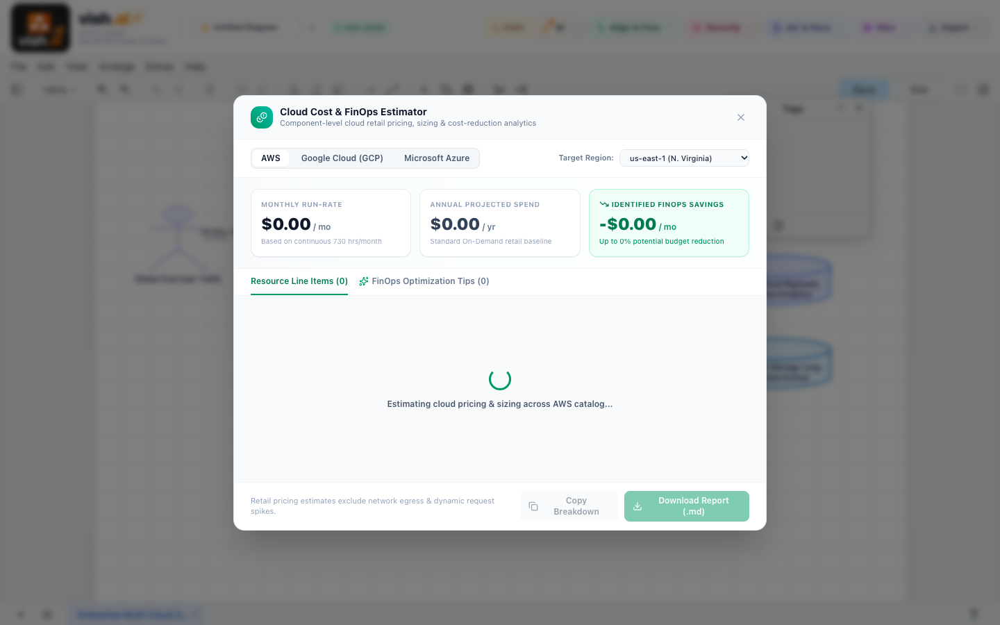

- **Multi-Cloud Mapping:** Normalizes diagram components into standard compute, storage, network, and database classes.
- **Provider Comparisons:** Compares estimated monthly expenditures across AWS, GCP, and Azure.
- **FinOps Optimization:** Highlights underutilized provisioned resources, idle database read replicas, and opportunities for spot/savings plans.

---

### 4.3 STRIDE Threat Modeling
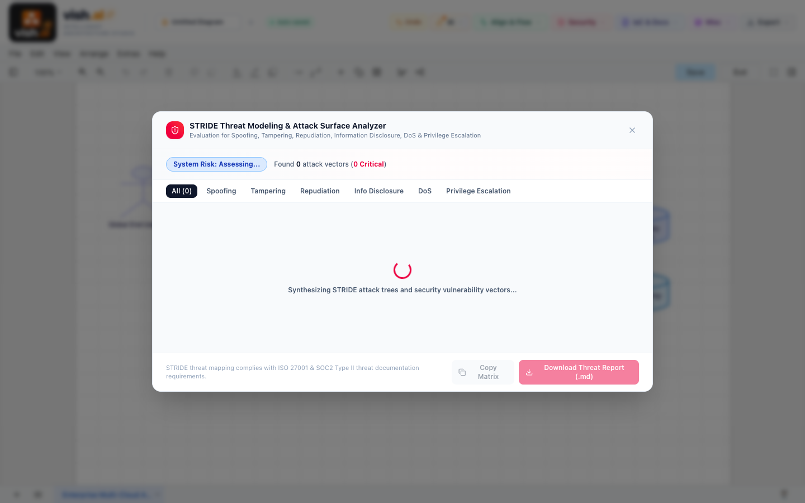

Maps architectural assets to the Microsoft STRIDE framework:
- **S**poofing: Missing identity validation on incoming edge paths.
- **T**ampering: Unauthenticated message queues or cleartext database connectors.
- **R**epudiation: Services lacking distributed trace IDs or access logs.
- **I**nformation Disclosure: Publicly accessible storage buckets or VPC egress holes.
- **D**enial of Service: Unthrottled API endpoints lacking rate-limiters.
- **E**levation of Privilege: Direct database access from frontend services without middleware.

---

### 4.4 Security & SOLID Architecture Auditor
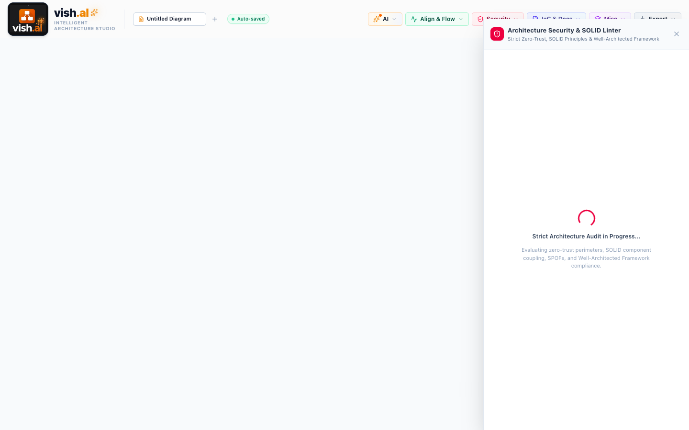

- Evaluates diagrams against AWS Well-Architected Framework pillars (Security, Reliability, Performance, Cost).
- Inspects network boundaries for proper VPC isolation and zero-trust segmentation.
- Validates SOLID architecture principles in software components (Single Responsibility, Interface Segregation, Dependency Inversion).
- Features one-click **"Auto-Fix"** to automatically insert recommended subnets, firewalls, and gateway nodes.

---

### 4.5 Command Palette (⌘K)
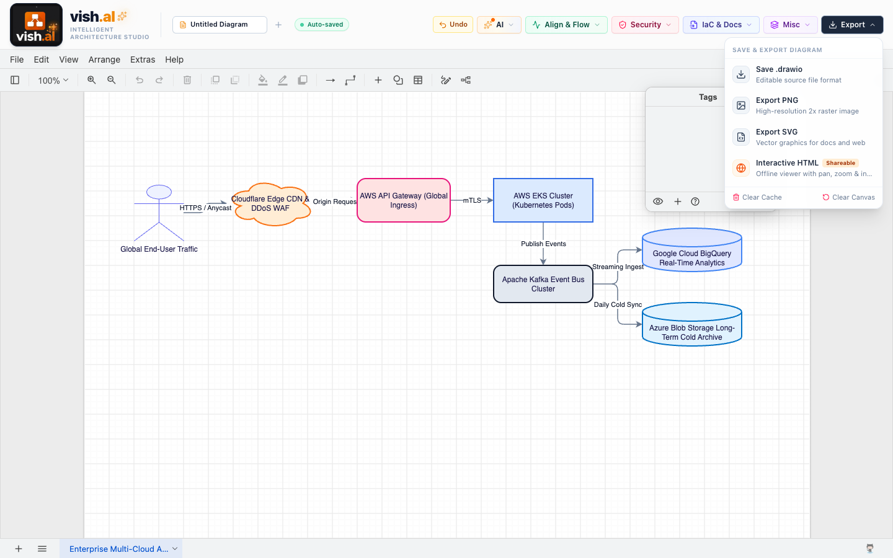

- Accessible anywhere via `⌘K` (macOS) or `Ctrl+K` (Windows/Linux).
- Fuzzy search indexing across all actions: AI Generation, Chaos Injection, FinOps Audits, Latency Profiles, and Export options.

---

### 4.6 Database SQL / Prisma to ERD
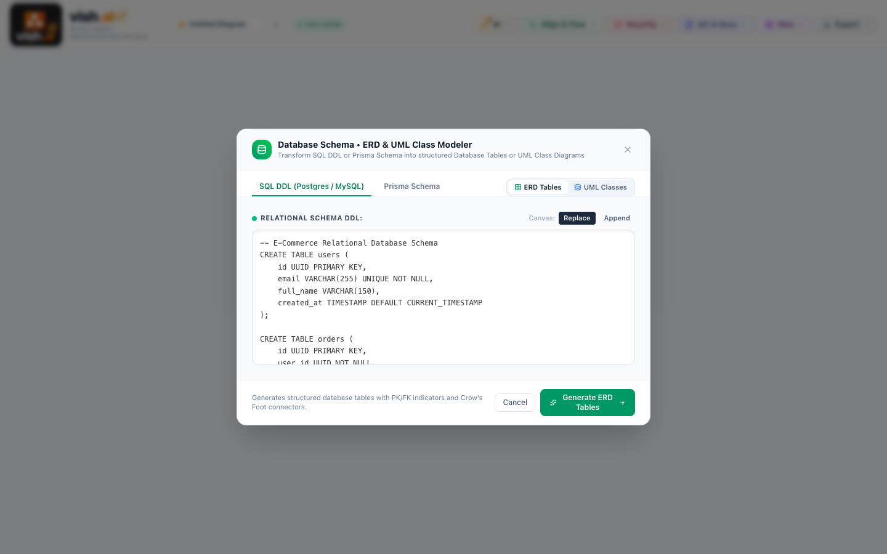

- Parses SQL `CREATE TABLE` DDL scripts, primary keys, foreign keys, and relations.
- Parses Prisma schema models, field types, `@id`, and `@relation` attributes.
- Generates relational tables with field types, keys, and connecting relationship lines on the canvas.

---

### 4.7 Reverse IaC Engine
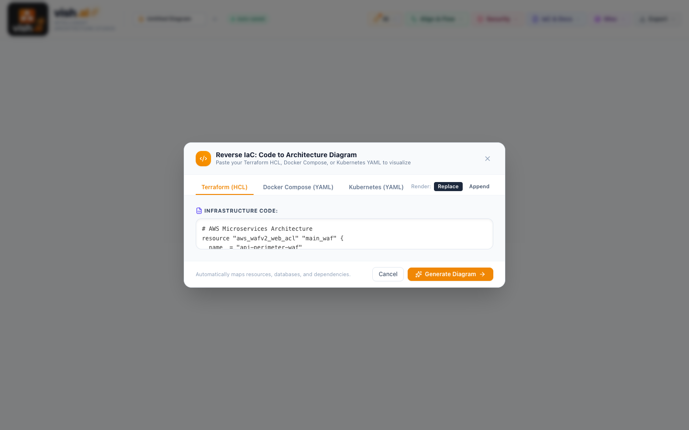

- Ingests Terraform `.tf` HCL, Docker Compose `docker-compose.yml`, and Kubernetes manifest YAML.
- Reconstructs visual cloud topology nodes with appropriate vendor logos, container tiers, and dependency arrows.

---

### 4.8 Architecture to AI Prompt Engine (Reverse Engineering)
- **Zero-Ambiguity Reverse Prompting:** Inspects the active canvas diagram (nodes, spatial orientation, tiers, directed connector hops, labels) and generates a structured, reproducible natural language prompt.
- **Reproducibility Guarantee:** Feeding this exact prompt into any LLM (or the built-in "Prompt to Architecture" generator) reproduces the exact same architecture design with high fidelity.
- **RFC Technical Specification:** Automatically generates a comprehensive Markdown specification containing Component Inventory, Interaction Matrix Table, and non-functional requirements.
- **Mermaid Export:** Generates clean, ready-to-use Mermaid.js flowchart code (`flowchart LR` or `flowchart TD`).
- **1-Click "Test & Re-Synthesize":** Allows engineers to immediately verify the prompt's reproducibility by re-generating and rendering the architecture directly on canvas.

---

### 4.9 Icon Beautifier & Web-Augmented Brand Logo Engine
The Icon Beautifier upgrades generic diagrams into polished, production-grade cloud architecture blueprints by replacing standard rectangle and cylinder boxes with official cloud and tech vendor stencils.

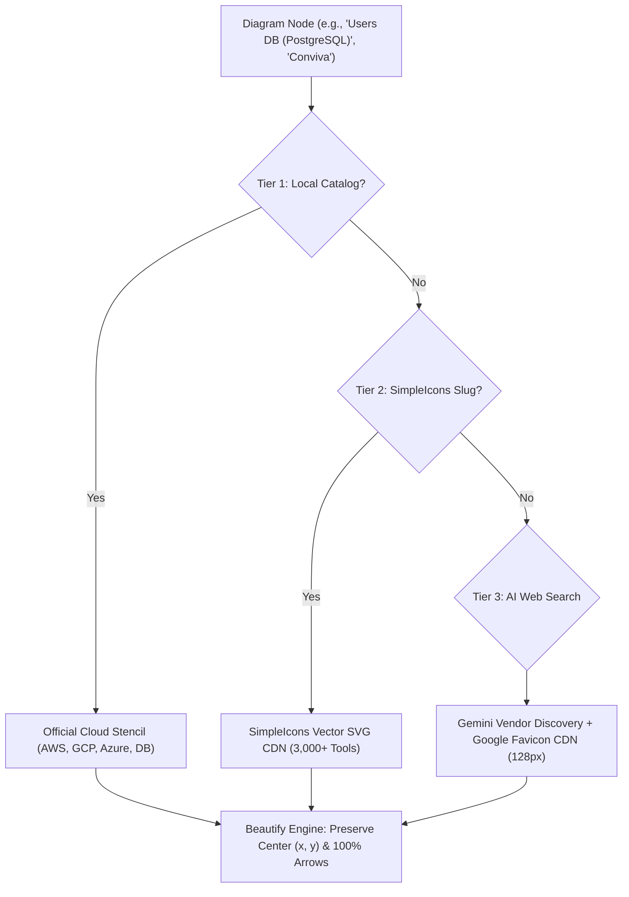

- **3-Tier Brand Resolution Engine:**
  1. **Tier 1 (Official Cloud Stencils):** Local regex definitions for standard AWS services (S3, RDS, Lambda, DynamoDB, API Gateway, SQS, CloudFront, Service/Data Catalog), GCP, Azure, Kubernetes, and Web Clients.
  2. **Tier 2 (Vector Tech Stacks via SimpleIcons):** 3,000+ developer and infrastructure tool SVGs including PostgreSQL, Redis, Apache Kafka, Docker, MongoDB, Snowflake, Datadog, Stripe, Auth0, Twilio, and Cloudflare.
  3. **Tier 3 (AI + Web Search Grounding via Gemini & Google High-Res Favicon CDN):** Dynamically identifies specialized B2B software vendors, OTT media streaming stacks (e.g. Conviva, Bitmovin, Axinom, DAZN), and SaaS platforms, fetching crisp 128px official logos (`https://t2.gstatic.com/faviconV2?url=...&size=128`).
- **Zero Data Loss & Strict Docking Guarantee:**
  - **100% of arrows and waypoints remain untouched:** Edge sources, targets, intermediate waypoints, and orthogonal styles are never altered.
  - **Center coordinate anchoring:** New stencil geometries are centered over the original bounding box:
    $$\text{newX} = \text{centerX} - \frac{\text{targetW}}{2}, \quad \text{newY} = \text{centerY} - \frac{\text{targetH}}{2}$$
  - **Unmatched safety:** Nodes that cannot be identified, flow decision diamonds, and container boundaries are left as-is without modification.
- **Interactive Preview & Web Search Modal:**
  - View live logo previews before applying changes.
  - Filter by provider (AWS, GCP, Azure, Database, DevOps, SaaS, Web).
  - One-click `🌐 Search Web Logos` to scan for brand logos across the web on demand.

---

### 4.10 Deterministic Layout Beautifier & Obstacle Avoidance Routing
Provides clean, consistent canvas layouts with mathematical collision prevention and routing guarantees:
- **Acyclic Graph Ranking & Infinite Loop Prevention:** Automatically handles bidirectional loops and circular dependencies by constructing an acyclic spanning tree for hierarchical tier assignment, preventing browser freezes.
- **Obstacle Avoidance Gutters:** Edge connectors are routed around intermediate node bodies, eliminating ugly lines cutting straight through text and shape interiors.
- **Perimeter Edge Docking:** Connectors dock cleanly at cardinal border points (top, bottom, left, right) rather than converging at internal node origins.
- **DOM Layer Ordering:** Connectors are serialized underneath vertex shapes in the mxGraph XML tree, ensuring node labels and icons are never obstructed.

---

### 4.11 Conversational Diagram Copilot & Directional Grammar
The Conversational Copilot translates natural language instructions into precise Draw.io canvas edits:
- **Fuzzy Anchor Resolution:** Queries like `"Add Catalog to display Error..."` automatically fuzzy-match the target node `"Display Error & Increment Attempts"`, avoiding failed lookups due to partial names.
- **Natural Language Directional Grammar:** 
  - Resolves semantic prepositions: phrases like `"Add Web to User Enters Credentials"` correctly detect that `"to"` signifies an upstream addition, placing the new `"Web"` node to the left/upstream and pointing the arrow `Web ➔ User Enters Credentials`.
  - Conversely, phrases with `"from"`, `"after"`, or `"right of"` position downstream and point `Anchor ➔ New`.
- **Direction Inversion:** Built-in command `"reverse arrow between [A] and [B]"` to flip arrowheads without redrawing connections.
- **Full Action Suite:** Insert, connect, rename, move, delete, and replace nodes conversationally.

---

### 4.12 UI & UX Ergonomics (Pinned Drawer Tabs & Responsive Chaos Controls)
- **Security & SOLID Audit Drawer:** Redesigned with sticky, pinned category tabs (`Critical`, `Security`, `Reliability & DLQ`, `SOLID`, `Performance`) at the top of the findings pane, ensuring category filters remain visible and accessible at all times regardless of scroll depth.
- **Responsive Chaos Simulator Bar:** The floating Chaos Engineering control bar is clamped to a maximum width (`max-w-xl`), prevents stretching on wide displays, features drag-and-drop repositioning, and filters out container/boundary groupings from target selection dropdowns.

---

## 5. Architecture & Communication Flow

The studio communicates with the underlying Draw.io iframe using a decoupled bidirectional postMessage protocol:

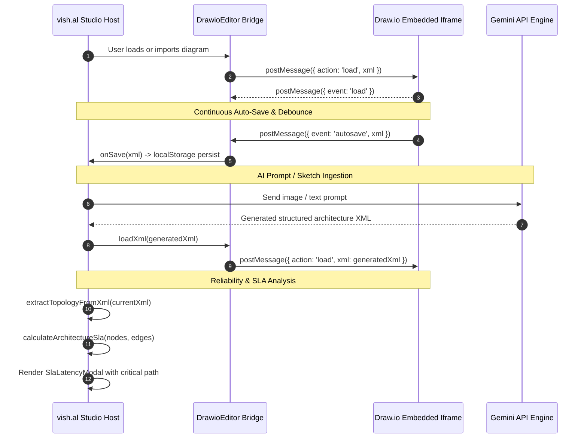

---

*Documentation compiled and maintained for vish.al Intelligent Architecture Studio.*

